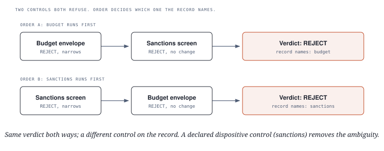
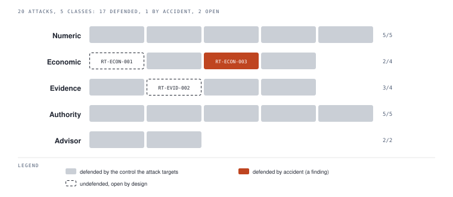
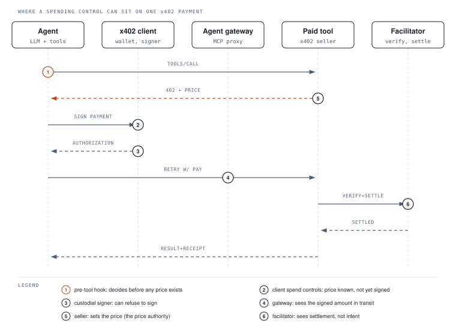
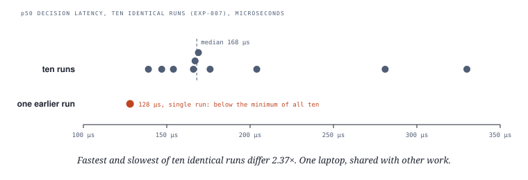

# Same verdict, different culprit

### Which control decided? Attribution and enforcement points for AI agent payments

**Jayath de Silva** ([ORCID 0009-0007-1855-4158](https://orcid.org/0009-0007-1855-4158)) · Independent · Draft v0.3, October 2026

> **Preprint draft.** Not peer reviewed, and not yet read by anyone who did not write it. Section 11
> argues that this is the paper's own open question.

**Links.** Paper: [DOI 10.5281/zenodo.23610076](https://doi.org/10.5281/zenodo.23610076) (all
versions) · Source and figures: [github.com/tesoro-labs/research](https://github.com/tesoro-labs/research) ·
Reference implementation: [tesoro](https://github.com/tesoro-labs/tesoro) (`pip install tesoro`) ·
Standard, vectors and conformance suite: [AEGS](https://github.com/tesoro-labs/aegs) · Try every claim
yourself: [Appendix A](#appendix-a--try-it-and-check-our-numbers).

## Abstract

AI agents can now pay for things on their own, over settlement rails that do not govern the payer.
Several systems published in 2026 put a deterministic check in front of an agent's action. We do not
propose another one. We argue that this category, which already has independent implementations, is
missing one property, and we work out what it costs to require it.

When controls can only make a verdict stricter, the final verdict is the strictest one any control
proposed, so the order the controls run in does not change it. The record of which control decided
is a different matter. The last control to tighten the verdict is the first one in the order to
reach the maximum, so attribution depends on order exactly when two or more controls reach that
maximum. That happens all the time: any two outright refusals tie at the top. A specification that
requires attribution therefore has to fix the evaluation order, and has to declare which controls
win a tie.

We make three small contributions. Attribution as a required output that a third party can score
from machine-readable vectors, on approvals as well as refusals. A disclosure rule we call *bounded,
not eliminated*, which obliges an implementation to state what its control leaves behind. And a
benchmark scoring rule, `DEFENDED_BY_ACCIDENT`, which counts an attack refused by a control that was
not aiming at it as a finding rather than a pass.

The paper also maps where such a control can sit on an x402 payment (a pre-tool hook, the
client's spend controls, a custodial signer, an agent gateway, the seller, the facilitator) and what
each position can and cannot see. A pre-tool hook decides before the seller has named a price. A
gateway sees the signed amount but cannot revoke it. No position holds an independent view of what
the price should have been.

The reference implementation scores 17 of 20 attacks defended, one by accident and two open by
design. The instrument has no benign scenarios, so an implementation that refused everything would
score perfectly; we found that defect by reading a competitor's design. Three prior-art surveys
removed three larger claims while we wrote this, and Section 3 reports each removal.

**Keywords:** autonomous agents, agent payments, x402, payment authorization, policy attribution,
conformance testing, adversarial benchmarking, agent gateways, stablecoins.

---

## 1 · An agent that can pay can overpay

The scale is already real. On 21 August 2026 the x402 protocol reported 75.41 million transactions
and $24.24 million of volume over 30 days, an average payment of $0.32. The protocol's own
documentation specifies no spend limits, no buyer-side authorization and no governance layer. That
is reasonable for a settlement rail, whose job is to move the money once asked.

So nobody in the transaction asks whether the buyer should have bought. The seller is protected by
being paid and the chain by finality. The only party with an interest in the question is the
person or organisation the agent works for, and they are not present when the payment happens and
may not hear about it for hours.

This paper is about the layer that sits in that gap, and about one property that layer should be
required to have.

### Others got here first, and that helps the argument

Three systems published in 2026 put a deterministic decision in front of an agent's action. OAP
intercepts tool calls at the framework layer and returns `ALLOW`, `DENY` or `ESCALATE` from a signed
policy pack, with an Ed25519-signed decision record per call [1]. PCAS compiles policy into a
Datalog-derived reference monitor and reports policy compliance rising from 48% to 93% across
frontier models [2]. PayBench benchmarks agents holding delegated payment authority across 226
scenarios, built as 113 matched pairs of a trap and a safe lookalike [4].

OAP's authors noticed the same thing: they and PCAS *"independently converge on the need for
deterministic pre-action enforcement as a distinct architectural layer … This convergence suggests
the category is real, not an artifact of a single system's design."* We agree, and we are the third
data point. So this paper does not propose a layer. It argues for one output that every such layer
should be obliged to produce, and shows that none of them is currently obliged to produce it.

### What we claim

1. **Attribution as a required, independently scored output.** The record names the control that
   decided, on approvals as well as refusals. When several controls would have refused, the rule for
   which one is named is fixed in advance. Requiring this forces a normative evaluation order, even
   though the verdict itself does not depend on order (Section 5).
2. **"Bounded, not eliminated" as a disclosure obligation.** Where a control limits a risk without
   removing it, the specification makes the implementation say so, and a conformance vector checks
   the statement (Section 7).
3. **A scoring rule, `DEFENDED_BY_ACCIDENT`.** In an adversarial benchmark of a control layer, an
   attack refused by a control it was not aimed at counts as a finding (Section 6).

### What is new here, and what is not

Most of this layer is not new, and the claims only hold up if that is said first.

| Already known, and conceded | Where it comes from |
|---|---|
| A deterministic check before an agent acts | OAP [1], PCAS [2], card authorization (ISO 8583) |
| Delegated authority that can only narrow | SPKI/SDSI [10], macaroons [9], Intent-Driven Computing's Coq proof [3] |
| A hash-chained journal with an external anchor | Certificate Transparency [11] |
| Policy as data, not code | XACML [12], OPA, Cedar |
| Spending limits per period, per merchant | card programmes; per-payment caps in the x402 client [18]; session budgets in AWS AgentCore Payments [23] |

| Claimed here | Closest prior art | What that prior art does not do | Shown in |
|---|---|---|---|
| The record must name the control that decided, on approvals as well as refusals, with precedence fixed in advance | OAP reason codes (refusals only); XACML's optional `PolicyIdentifierList` | require it, fix which control is named on a tie, or make it checkable by a third party | Sections 3.5, 5 |
| Attribution depends on evaluation order exactly when two controls tie at the strictest verdict | proofs that narrowing composes [3] | state that the verdict is order-free while the attribution is not | Section 5.1, [`lattice.md`](https://github.com/tesoro-labs/research/blob/main/lattice.md) |
| A control that bounds a risk must say so, and a vector scores the admission | standards that specify what a control does | require a statement of what it leaves behind | Section 7 |
| `DEFENDED_BY_ACCIDENT`: a refusal by a control the attack did not target is a finding | PayBench's trap and lookalike pairs [4]; OAP's capture-the-flag [1] | ask whether the refusing control was the one aimed at the attack | Section 6 |

*Table 0. What this paper concedes and what it claims. Section 3 gives the reading behind each row.*

Section 8 adds an analysis we do not claim as a contribution: where on the payment path such a
control can sit, and what each position can see.

These claims are small on purpose. Three prior-art surveys each removed a larger claim, and one
removed a claim we had invented that same day. We would rather defend three narrow points than spend
a reviewer's afternoon on a fourth.

---

## 2 · Why the check has to come first

The controls in this space look odd until you look at how the money settles.

A card payment can be undone. Authorization, clearing and settlement happen at different times, a
cardholder can dispute, and an issuer can charge back. Every control in that system can rely on
one fact: finding a fraudulent payment on Tuesday can still reverse a payment made on Monday. That
makes monitoring and after-the-fact review worth the investment.

A stablecoin transfer on a public chain has no chargeback, no recall, and no issuer standing behind
the payer. Once it is final, a control that notices a problem can only describe the loss.

Two things follow.

The check moves to before the payment. A pre-execution control is not better in general, and the
next paragraph but one says where it is worse. It is the only control whose output can still change
what happens.

A refusal has a cost that has to be counted. Refusing a legitimate payment on an irreversible rail
means the principal does not get what they wanted, and there is no dispute process to fix it later.
That works against the instinct to refuse whenever in doubt. It is why the benchmark in Section 6 should
treat over-refusal as a defect, and why Section 10 reports that our own instrument cannot measure it.

The early check pays for being early. It decides on less information than a later one would have.
It cannot see whether the goods arrived, whether the counterparty later turned out to be a fraud, or
whether the same pattern repeated across a hundred other principals. Systems that monitor after the
fact can see all of that. We do not claim the early control is more accurate. We claim it is the
only one that can still change the outcome, which makes the loss of accuracy a forced trade.

---

## 3 · Who else is building this, and what their work took from ours

This section is longer than the claims it supports, because the claims rest on what the surveys
removed.

### 3.1 Pre-action authorization in 2026

OAP [1] is the closest work. It is deterministic (*"Same inputs, same decision. No sampling, no
temperature"*), runs at the framework layer so the model's reasoning cannot route around it, fails
closed, and signs and timestamps a record for every decision. A denial carries a structured reason
code such as `oap.limit_exceeded` or `oap.merchant_forbidden`, with a readable explanation. It was
tested against 4,437 adversarial decisions across 1,151 attack sessions in a live capture-the-flag
against a banking agent, with outside participants.

That last number beats anything we report, on the axis Section 10 names as our weakest. Our attacks were
written by the author of the system under test, and OAP's were not.

OAP's limitations section records that it does not yet formalise a delegation model (*"planned for
v1.1"*), that its `ESCALATE` path is specified but not implemented in the reference, and that
structuring across a sequence of actions is future work.

PCAS [2] is the strongest academic work in this space. Its system, FORGE, models an agent's run as a
dependency graph of causal links between messages, tool calls and tool results, because policies
about information flow cannot be expressed over a flat transcript. Policies are Datalog-derived rules
over transitive flow and cross-agent provenance, and a reference monitor blocks violations before they
run. It reports compliance rising from 48% to 93% across frontier models on a customer-service
benchmark.

Reading the PCAS paper itself, rather than OAP's description of it, changed two of our conclusions.

PCAS attributes events to entities. Its principal function maps each event to the entity that
produced it, which answers *who acted*. Our claim is about *which control decided*, and the paper
never asks that question. So PCAS is a third independent system that puts a deterministic decision
before an action without requiring the record to name the control behind it, and it is the
strongest support claim 1 has.

PCAS governs information flow, and we govern money. FORGE has no envelopes, no integer minor units,
no settlement and no irreversible rail. Payments appear in its evaluation only as content in a
retail benchmark. Neither system covers the other.

PayBench [4] benchmarks agent behaviour under three conditions (no policy, a policy in the prompt,
hard tool constraints) using matched trap and lookalike pairs, so that an agent that refuses
everything cannot score well. EcoAgent-Bench scores the quality of agents' economic decisions under
budget constraints rather than enforcement. Faramesh is an execution-time control plane.
ToolMisuseBench is an offline harness that separates failures in building a call from failures in
handling policy and recovering.

### 3.2 Policy languages

An XACML 3.0 response may carry a `PolicyIdentifierList` [12], so "which policy decided" has been
expressible in a standard from that lineage for twenty years. OPA and Cedar are the current form of
policy as data. Our claim is therefore not that attribution was impossible to express. Section 3.5 says what
is left.

### 3.3 Capability security, and the claim it removed

SPKI/SDSI [10] reduces a chain of delegation certificates to one effective authority by intersecting
what each step allows. Macaroons [9] attenuate a credential by adding caveats that can only restrict
it. The object-capability model has attenuating proxies and membranes. Intent-Driven Computing [3]
proves in Coq that *"capabilities can only narrow, never widen, through composition"*.

An earlier version of this paper claimed a narrowing-only delegation clamp as a contribution,
because OAP lists delegation as unformalised. That was true of OAP and false of the field, and we
withdrew the claim. Delegated authority that can only narrow is a thirty-year-old idea with a
machine-checked proof.

All of that work computes or proves the result of attenuation. None of it names the step that
produced the result. That is an attribution question, so it lives inside claim 1.

### 3.4 Transparency logs, and the claim they shrank

Certificate Transparency commits a log to a signed tree head, which signs the tree's size and its
root hash [11]. Our evidence anchoring is that mechanism applied to a spending journal. The survey
that showed this refuted the novelty we had claimed, and the clause survives as engineering.

### 3.5 What survives

Every surveyed system that attributes at all attributes a refusal. OAP's reason codes attach to
`DENY`, and XACML allows a policy identifier without requiring one.

| What the record must do | OAP [1] | PCAS [2] | XACML [12] | Card authorization | This paper |
|---|---|---|---|---|---|
| Name the control behind a refusal | reason code on `DENY` | not asked | optional | decline code | required |
| Name the control behind an approval | no | no | optional | no | required |
| Fix which control is named when several refuse | no | no | no | issuer's choice | required |
| Be scorable by a third party from vectors alone | no | no | no | no | required |
| State that attribution depends on order | no | no | no | no | Section 5 |

*Table 1. What surveyed systems require of the decision record, as read from their published
material; the card column follows the description of ISO 8583 in Section 4 and is not separately cited. "No"
means we found no such requirement, which is weaker than finding it absent by design.*

Those four requirements, plus the order argument behind them, are claim 1.

### 3.6 What we did not survey

Transaction monitoring and AML systems, cloud and FinOps quota systems, NIST AI RMF and EU AI Act
traceability, and agent governance frameworks other than Microsoft's Agent Governance Toolkit. We do
not think they touch the three remaining claims. We thought the same about capability security on
the morning of the day it removed one.

---

## 4 · What counts as a governance layer (card networks included)

> An **autonomous economic governance layer** renders a deterministic, attributable verdict on a
> proposed economic action before that action is executed, and emits evidence sufficient to
> reconstruct which control produced the verdict.

Each part of the definition excludes something.

*Deterministic* means the same inputs give the same verdict, and the verdict can be replayed from
the record. A model sampling at a temperature above zero cannot sit in the decision path. A model
can still sit in the system as an adviser that may tighten a verdict and may never loosen one, which
keeps the decision reproducible while letting judgement make it stricter.

*Attributable* means the record names the control that produced the verdict. Section 5 works out what that
costs.

*Before execution* means the verdict arrives while refusing is still free. Afterwards a control can
only describe.

*Evidence sufficient to reconstruct* means enough state to derive the conclusion again: the inputs,
the identity of the policy, and the control that decided. A log line that asserts a conclusion is
not enough.

### Card authorization qualifies, and that is deliberate

A card authorization system meets every part of the definition. It decides before the money moves,
it decides from rules the issuer set, it returns a reason code, and it keeps a record. ISO 8583 has
carried a decline-reason field since the 1980s.

A definition of a governance layer that excluded the most widely deployed governance layer in the
world would exist to make its author's system look new. The useful question is what changes when the
payer is software acting on authority granted earlier, on a rail with no chargeback, at a rate no
cardholder generates.

Card networks also supply the strongest objection to claim 1. They deliberately do not tell the
cardholder which rule declined them, because a fraudster who learns the rule can work around it.
Attribution has a real security cost.

Our answer depends on who reads the record. Here the reader is the operator who wrote the policy. A
principal reading their own agent's refusal is not probing an issuer's fraud model; they set the
limit and need to know which limit bound. A record shown to a counterparty is a different audience.
The layer described here shows a seller a strict subset of the record, and that subset never says
which control decided.

---

## 5 · Why attribution forces an evaluation order

This is the paper's main claim, and it comes down to one observation about systems whose controls
can only tighten a verdict.

### 5.1 Order does not change the verdict. It changes the record.

Take a layer in which each control may make the standing verdict stricter and never more permissive.
Rank the verdicts by severity: `APPROVE`, `REVIEW`, `ESCALATE`, `REJECT`.

The final verdict is then the most severe one any control proposed. Taking a maximum is commutative
and associative, so the final verdict does not depend on the order the controls ran in. Every system
in Section 3 has some version of this property.

Now ask which control decided. Define the attributed control as the last control that tightened the
verdict. This is well defined because loosening is impossible, so a control proposing something no
stricter than the current verdict changes nothing.

Once the running verdict reaches the maximum, nothing after it can tighten it. So the last control to
tighten is the first control in the order to reach the maximum, and:

> Attribution depends on evaluation order if and only if more than one control proposes the maximum.

An earlier draft of this paper, following the specification's own rationale, illustrated
order-dependence with a budget envelope tightening to `REVIEW` and a risk score then tightening to
`ESCALATE`. That example is wrong. Only the risk score reaches `ESCALATE`, so risk is named under
both orders. Formalising the lattice caught the mistake, and both the specification and this section
are corrected [13].

A real example needs a tie. Take a payment to a sanctioned counterparty that a spending limit also
refuses. Both controls propose `REJECT`, and whichever runs first takes the attribution.

<figure>

<figcaption>Figure 1. The verdict is the same in both orders. The control named on the record is not.</figcaption>
</figure>

Ties are the normal case. Any two outright refusals meet at the maximum: a barred counterparty, an
exhausted budget and a revoked identity all produce `REJECT`.

So the moment a specification requires attribution, it takes on an obligation the verdict never
imposed: it has to say something binding about evaluation order. It cannot know in advance whether a
given decision will have a tie at the top, so it has to fix the order for every decision. Order does
not change what happens. It changes what the record says happened.

We suspect this asymmetry is why no surveyed system requires attribution. The verdict is the part
that matters operationally, the verdict does not care about order, and it is easy to conclude from
that that order does not need specifying.

### 5.2 "The last control that tightened" is a good default with one bad failure

In the sanctions example, under the default rule the budget tightened the verdict first and the
sanctions screen changed nothing, because the verdict was already `REJECT` when it ran. The record
says the agent was stopped by a spending limit. In fact it tried to pay a sanctioned party. An
operator who responds by raising the limit finds the payment still refused, with nothing on the
record to explain why.

Some findings are categorical. A counterparty is barred or it is not, and that stays true whether or
not another constraint happened to bite first. A specification that requires attribution must
therefore let an implementation declare certain controls *dispositive*: when their finding is
present, they get the attribution whether or not they tightened anything.

The formalisation shows why this mechanism is needed. A total order on verdicts cannot tell apart two
controls that both reach the maximum, because the lattice has no structure left to break the tie.
Something outside it has to, and a declared precedence among dispositive controls does. Where such a
finding is present, attribution stops depending on evaluation order at all.

This clause exists because the earlier rule was wrong and a conformance vector caught it.

### 5.3 Declaring in advance is what stops this being an escape hatch

If an implementation could nominate any control as dispositive after the fact, it could attribute a
decision to whatever was convenient. Two requirements prevent that. The set of dispositive controls,
and their precedence among themselves, is fixed in advance and in writing. And the evaluation order
must be documented, though the specification does not choose it.

The second requirement is a little uncomfortable. A standard cannot impose a sequence on controls it
does not know about. But an implementation whose order is undocumented has an attribution nobody can
predict, and so an attribution nobody can audit, which is the failure this section exists to
prevent.

One consequence: a dispositive control must record its finding every time, because attribution now
depends on the finding being present rather than on its having changed the outcome. A control that
stays silent when it did not tighten anything cannot be dispositive.

### 5.4 Naming the control behind an approval

Every system in Section 3 that attributes at all attributes refusals, which is the natural place to start:
somebody is inconvenienced and wants an explanation.

The approval record is more useful. *"This payment was approved, and the control that let it through
was the budget envelope with $12.40 of headroom"* answers a question no refusal record can: would
deleting this control have changed anything you can observe? A layer whose controls all approve in
silence looks, from outside, exactly like a layer with no controls. The only way to tell them apart
is to make the approval path name its decider too.

### 5.5 The test this makes possible

Requiring attribution turns an assurance nobody can test into one anybody can:

> Delete a control. Does any record change?

If not, the control was decorative, and removing it would be invisible to every audit. A third party
can run this check with only the record format and a set of vectors, without access to the
implementation or help from its author. That is what "independently scored" means here, and it is
the part Section 3.5 found unclaimed.

---

## 6 · Counting lucky refusals as findings

### 6.1 Four outcomes instead of two

An adversarial benchmark of a control layer usually records two outcomes per attack: it worked, or it
did not. We record four, and the second is the contribution.

| Outcome | Meaning |
|---|---|
| `DEFENDED` | Refused by the control the attack targets |
| `DEFENDED_BY_ACCIDENT` | Refused by a control that was not aimed at this attack |
| `UNDEFENDED` | Not refused |
| `ERROR` | The attack did not run |

An accidental defence counts as a finding because a coincidence has no maintenance contract. A
trust-farming attack refused by a return-on-investment rule that happened to fire is refused today,
and may not be after somebody retunes an unrelated weight. Nothing in the record will show a
regression, because nothing that was ever asserted stopped being true.

Attribution (Section 5) is what makes this outcome visible. Without a record naming the control that
refused, an accidental defence and a deliberate one look the same from outside.

None of the systems in Section 3 has this outcome. OAP records a deny code but does not ask whether it was
the code aimed at the attack. PayBench scores whether a refusal was appropriate, not where it came
from.

The newest attacks found a defect. Two advisor attacks were added in August 2026, both assuming a
counterparty's text completely takes over the advisory model. The first confirmed the clamp holds.
The second had the adviser return a string that is not one of the four verdicts, and that raised an
unhandled exception out of the decision path. The layer failed closed by crashing: no verdict, no
attributed control, no record. A decision that never finishes has none of the four states to
report, which the state vocabulary cannot express and the benchmark can.

`ERROR` is kept separate for a reason learned the hard way. An attack with no handler silently
reports nothing, and a suite full of errors looks like a clean run to anyone reading only a failure
count. A test asserts that every attack executed.

### 6.2 The instrument, including what is wrong with it

Twenty attacks in five classes: numeric, economic, evidence, authority and advisor.

<figure>

<figcaption>Figure 2. Outcomes by attack class. The single accidental defence is trust farming (RT-ECON-003): the strike is refused by a return-on-investment rule, and the risk control the attack targets never acts.</figcaption>
</figure>

The current score, 17 defended, 1 by accident, 2 undefended and 0 errors, is recorded in
`redteam/baseline.json` in the reference implementation [14]. A test compares every live run against
that file and fails on any difference in either direction, because a gap that closes is as much a
deliberate change as a regression. A live run on 23 October 2026 matched it. The last sealed,
checksummed experiment record, EXP-010 [15], covers the first eighteen attacks (15 / 1 / 2 / 0); the
two advisor attacks are in the baseline file but not yet in a sealed record. Version 0.1 of this
paper said the twenty-attack score was in a sealed record, which was not accurate.

Three properties of the instrument belong here rather than in Section 10.

It is small, and nobody outside attacked it. OAP's capture-the-flag produced 4,437 adversarial
decisions across 1,151 sessions with outside participants. Ours has twenty attacks, all written by
the author of the system under test.

It has no benign twins. PayBench pairs each trap with a safe lookalike, so an agent that refuses
everything cannot score well. We have no such pairing. An implementation that refused all twenty
attacks would score 20 out of 20, so the instrument does not measure over-refusal at all, which Section 2
argues is the expensive failure on an irreversible rail. We found this by reading a competitor's
design.

Two findings stay open. Structuring is bounded rather than refused, for reasons given in Section 7.
Truncating the journal is caught only against an external anchor, and none ships by default, so the
benchmark reports what an installer actually gets.

### 6.3 The record history, including a wrong measurement

The sealed records behind the score run EXP-008, then EXP-009, then EXP-010. EXP-009 supersedes
EXP-008 because a measurement in it was wrong: an attack was set up over a time window its target
control could not observe, so the result described the setup rather than the control. EXP-008 was not
edited. It remains, marked superseded, with the reason attached.

A history that contains a correction says more about the method than a clean one. A benchmark whose
history shows no errors was either run very carefully or tidied very carefully, and a reader cannot
tell which.

---

## 7 · Bounded, not eliminated

The third claim is a disclosure rule: where a control limits a risk without removing it, the
specification must require the implementation to say so.

Standards usually say what a control must do. This clause says what an implementation must admit
about what its control leaves behind. Both cases below ship with a conformance vector that asserts
the limit, so the admission is scored.

### 7.1 Count envelopes: from unlimited to limited by a number you chose

A rate limit caps how fast an agent acts. A value envelope caps how much it spends. Neither caps how
many times it acts over a window longer than the rate limit's, and nothing multiplied a trivial
amount by a large count and compared the result to anything.

We measured the consequence. An agent pacing at 97 actions an hour, three per cent under a ceiling
of 100, stayed compliant indefinitely: 2,328 actions a day, $2.33 spent, against a $50 daily budget.
Each action was too small to reach any value envelope, and the pace stayed under every rate limit.

A cumulative count envelope closes this. The paced-evasion attack moved from undefended to defended,
refused at action 500 and attributed to the treasury control citing `actions_per_day`.

It does not end structuring, and the specification requires saying so. Forty payments of $0.001,
five minutes apart, total $0.04 and come nowhere near 500 actions. The envelope limits the mechanism
at a number the operator chose. It does not refuse this case, and it should not: forty small
purchases in an afternoon is also what a legitimate agent does. Refusing it would be a false positive
on an irreversible rail, which Section 2 counts as a real cost. The attack stays in the benchmark as
`UNDEFENDED`.

### 7.2 Anchoring: truncation caught beyond a bound the operator chose

A hash chain catches edits, but it cannot catch someone cutting off its end, because any prefix of a
valid chain is itself a valid chain. What is missing is the fact that there was more, and no amount
of internal linking supplies it.

An external anchor does: a commitment to the journal's length and head, published where the
journal's writer cannot reach. This is Certificate Transparency's signed tree head [11] applied to a
spending journal, and Section 3.4 records that the survey showing this refuted our novelty claim.

The bound is the honest part. Anchors are published at some interval, so everything written since
the last one can still be cut off without trace. Anchoring makes truncation detectable beyond a
bound the operator chose, and a conformance vector asserts that difference.

Verification therefore has four outcomes: `consistent`, `truncated`, `diverged` and `unknown`.
`unknown` is never a pass. An anchor that cannot be read is a fact about the anchor, and treating it
as agreement would let anyone who can cut the verifier off from the anchor make a truncated journal
verify.

No anchor ships with the implementation. An append-only file next to the journal is just the journal
again wherever the agent's own machine can rewrite it, and shipping one would make the gap look
closed.

---

## 8 · Where should the control sit? Hooks, SDKs, gateways and signers

The argument so far applies wherever the control runs. In practice the question people ask first is
where to put it, and on an x402 payment there are six candidate positions, each seeing a different
part of the transaction.

<figure>

<figcaption>Figure 3. One x402 payment over MCP [19] and the six places a control can act. The price exists only after the seller's 402 reply, so a control at position 1 decides before there is any price to check.</figcaption>
</figure>

### 8.1 What each position can see

| Position | Examples | Sees the price | Sees what is signed | Outside the agent's process | Can stop the money | One budget across agents |
|---|---|---|---|---|---|---|
| 1 · Pre-tool hook | Claude Code `PreToolUse` [24], ADK `before_tool_callback` [25], OAP [1] | no | no | no | yes, by blocking the call | no |
| 2 · Client spend controls | x402 `maxAmountPerPayment`, `onBeforePaymentCreation` [18] | yes | yes, it signs | no | yes | no |
| 3 · Custodial signer | AWS AgentCore Payments [23] | yes | yes | yes | yes, by not signing | yes, per session |
| 4 · Agent gateway | MCP proxy policy (WSO2 API Platform; agentgateway proposal [22]) | yes | yes, after signing | yes | only on this path | yes |
| 5 · Seller | x402 resource server [19] | sets it | yes | n/a | for its own sales | n/a |
| 6 · Facilitator | x402 facilitator | yes | yes | yes | can refuse to settle | n/a |

*Table 2. Author's reading of each position from its documentation (references marked `[read]`).
Only positions 2 and 4 were exercised in code. Position 4 was exercised by a spike policy on the WSO2
API Platform gateway, run once against a mock seller, and by its successor, which is unit-tested only.
Nothing in this table was measured.*

A few of these cells deserve a sentence.

A pre-tool hook decides before any price exists. In x402 the first `tools/call` carries no payment;
the seller answers with a 402 naming the price, and only the retry carries a signed authorization
[19]. A hook can govern which tools an agent may call and with what arguments. It cannot hold a
spending envelope against an amount it never sees, unless the price was declared somewhere in
advance. Hooks also run inside the agent's environment. Claude Code's documentation says handlers
*"run in the current directory with Claude Code's environment"* [24]. A control there protects
against a confused agent. Against a compromised one it holds only if the agent cannot reach the
signing key some other way.

The client's spend controls are at the right moment: price known, nothing signed yet. The x402 client
ships a per-payment cap (`maxAmountPerPayment`, default $1 on recognised USD assets), an asset
allowlist, and a hook before payment creation [18]. A per-payment cap is not a budget: nothing there
sums payments across time, and a cap held in one process does not see another process spending.

A custodial signer is the strongest position, because a payment it does not sign cannot happen. AWS
describes AgentCore Payments budgets this way: *"Each PaymentSession has a configurable budget limit
(maxSpendAmount, currency) and an expiry time. When the session expires or the budget is reached,
further payment requests are denied."* [23] The cost is custody: someone has to hold the keys.

A gateway sits outside the agent and sees the exact amount signed, so it can keep a budget per
authenticated agent across every tool behind it. It sees the payment only after the agent has signed
it. Refusing to forward stops settlement through the gateway, but an EIP-3009 authorization stays
valid until its `validBefore` time. A gateway is a control only if agents can reach paid tools
through it and nowhere else, which is a network rule rather than a gateway feature.

### 8.2 What people building this are saying

These are public statements, quoted as published, with dates.

On the x402 client, an open issue filed on 21 October 2026 [21] reports a reproduced overpayment
against an adversarial server and states the core of it: *"in the default configuration the client
treats the amount of the 402 accepts[] entry as the price to pay."* Its title ends: *"spend limit is
the only guard"*.

On putting payment awareness into an agent gateway, a maintainer of agentgateway replied on 8
September 2026 to a proposal for passive observability of agent payments [22]: *"In theory I think
this is in scope. … Especially with observability only I think it makes things much more viable."*

On a managed signer, AWS's documentation states the budget rule quoted in Section 8.1 [23]. It describes
when payments are denied. In the documentation we read it does not describe a record of which limit
denied a payment.

### 8.3 Gaps no single position closes

**The price is the seller's word.** Issue [21] shows the problem from the buyer's side. A check that
the signed amount equals the agreed amount catches tampering between agreement and signature, but if
the seller inflates the price, both numbers are inflated and agree. Per-payment caps and per-payee
envelopes limit the damage without detecting it. x402's Offer and Receipt extension lets a server
sign the terms it offers [20], which makes the seller's commitment checkable afterwards; it is still
the seller's price. None of the six positions holds an independent view of what a resource should
cost. That needs a source of price expectations outside the seller, which we did not find specified
anywhere.

**Budgets split across layers disagree.** A deployment with a hook, client spend controls and a
gateway has up to three places holding a version of the budget. They count different things: the
client counts what it signed, the gateway counts what it forwarded or saw settle, and a hook counts
calls. After a failed settlement or a retry, the three totals differ. None of the surveyed systems
says which one is authoritative or how they reconcile.

**Attribution has to name the layer as well as the control.** Section 5 showed that two controls in one
layer can tie at `REJECT`, and that the record then needs a fixed rule for which one it names. Two
layers that both refuse produce the same tie one level up. If the client's cap and the gateway's
envelope would both have refused, a record that says only "budget" does not tell the operator which
budget to change. Defence in depth multiplies these ties. We think the record should name the layer
and the control, and we have not specified how.

**A refusal in transit does not revoke a signature.** This is specific to positions 4 to 6, which act
after signing. Bounding `validBefore` at the gateway would shorten the window in which a refused
authorization could be replayed elsewhere. Nothing we surveyed does it, including our own gateway
policy.

---

## 9 · What a decision costs

A pre-execution control sits on the critical path of every payment, so its cost matters. We report
the measurement with its variance, because the variance turned out to be the result.

### 9.1 The numbers

Three thousand decisions in ten runs, against the published package installed from PyPI into a clean
virtual environment, which is what a user gets [15].

| | Median across runs | Range | Spread |
|---|---|---|---|
| p50 | 168 µs | 139 to 330 µs | 2.37× |
| p99 | 397.5 µs | 272 to 1,218 µs | 4.5× |

No model is called and inference costs nothing. The decision path invokes nothing probabilistic, so
the figure belongs to the code rather than to a provider's queue.

<figure>

<figcaption>Figure 4. Ten identical runs of the same measurement. The earlier single-run figure sits below the fastest of the ten.</figcaption>
</figure>

### 9.2 The variance is the finding

Ten identical runs gave p50 figures spanning 2.37×. The instrument was one laptop, in use for other
work during the runs, and the sealed record says so.

The rule that follows: a single-run figure for this measurement has no error bar and must not be
quoted as precise. That includes our own. An earlier experiment reported 128 µs from a single run,
which is below the minimum of the ten runs measured later. It was not wrong when taken. It could not
be repeated, and quoting it would have implied a precision the method never had.

### 9.3 The comparison we are not making

OAP reports 53 ms p50 for its cloud API and 174 ms for local evaluation. Ours is 168 µs. That looks
like three orders of magnitude, and it is not a fair comparison, so we do not make it.

OAP's cloud figure includes processing at an edge network and leaves out the client's round trip.
Its local figure is dominated by Python subprocess overhead. Ours is an in-process function call with
no network, no subprocess and no signature check on the path. A portable credential verified by an
independent service does work an in-process library skips, and that work is why someone would choose
it.

What the numbers do show is narrow: a deterministic decision before a payment need not cost a network
round trip, and where the layer runs inside the agent's process it does not. Whether that is
acceptable depends on whether the deployment can accept the trust that comes with running in the
agent's process, which Section 8.1 and Section 10 leave open.

---

## 10 · Limitations

This section collects the limitations of every sealed record cited, plus those of the work as a
whole.

### 10.1 The benchmark

Every attack was written by the author of the system under test. This is the largest hole in the
paper. An adversarial benchmark written by the defender measures what the defender thought to try,
and nobody knows how well that matches what an attacker would try. OAP's capture-the-flag with
outside participants is better on exactly this point (Section 3.1).

There are no benign twins, so over-refusal is not measured. An implementation that refused all
twenty attacks would score 20 out of 20. PayBench's matched pairs exist to prevent that, and adopting
them would change what our score means. Until then the score is an upper bound on defence and says
nothing about false positives, which Section 2 argues is the expensive failure on an irreversible rail.

Twenty attacks is a small number, and the same author chose the five classes.

The threat model is an adversarial agent, not an adversarial host, and one exposure we measured falls
outside it. The value envelopes add up settled payments only, so an authorization nobody reports
back on consumes no budget: ten $9 authorizations against a $50 daily ceiling leave the counter at
zero. We wrote an attack for this and withdrew it, because the agent does not decide whether
settlement is reported; the embedding process does, and this threat model trusts it. Turning it into
an agent attack would have meant giving the attacker a capability the model does not give it. The
exposure is real, a separate reconciliation surface reports it, and we name it here instead of
counting it in the score. A threat model with an untrusted embedding process is reasonable (it is
what a provider running someone else's agent would want), and it is not the one measured here.

The twenty-attack score lives in a baseline file checked by a test. The last sealed record covers
eighteen attacks (Section 6.2).

### 10.2 The measurements

One laptop, in use for other work, running Windows 11. The p50 varies 2.37× across identical runs. No
measurement was taken on server hardware, under concurrency, or with a cold cache. The p99 figures
span 272 to 1,218 µs, and we make no claim about the tail under load. Nothing was settled and no model
was called: this is the decision path on its own, not a payment end to end.

### 10.3 The standard

There is one implementation, and the same person wrote it and the standard. A specification with one
implementation describes that implementation, and nothing more that person does can change it. The
vectors are machine-readable and the conformance suite installs separately so that a second
implementation needs nobody's permission. Whether one appears is outside our control, and it is the
question Section 11 ends on.

Four adjacent fields are unsurveyed (Section 3.6).

### 10.4 Scope

Everything measured here is x402 with stablecoin settlement. The card, AP2 and bank bindings exist
as specified shapes and are not implemented, so any claim of generality is untested.

The placement analysis in Section 8 is a reading of documentation. Positions 1, 3, 5 and 6 were not
exercised in code by us. Position 4 was exercised by a spike policy run once against a mock seller,
and by a successor policy that has been unit-tested and not yet run on a gateway.

Two red-team findings are open by design: structuring is bounded rather than refused (Section 7.1), and
journal truncation is caught only against an external anchor, none of which ships (Section 7.2).

No compliance with any framework is claimed. The obligations discussed in Section 2 and Section 4 fall on issuers,
service providers and obliged institutions [16, 17]. The Travel Rule's required data names whose
money moved and not who instructed the payment [5, 6], and the message formats that carry it either
make an initiating party optional (pacs.008 [7]) or have no such element (IVMS101 [8]), so a payment
an agent made leaves no trace of the agent in that record. The layer described here is a library and is none of
those. It uses compliance signals and does not produce them: it performs no sanctions screening,
holds no list, and implements no transfer-information protocol.

The specification defines a vertical profile requiring a recorded AML position, and the reference
implementation does not meet it, because it has no AML control and so emits no assessment. A profile
the reference implementation fails is better evidence that the profile measures something than one
it passes.

---

## 11 · The question we can't answer from inside

The argument fits in three sentences.

Where a control layer decides before an irreversible payment, the verdict does not depend on order
and the attribution does, so a specification that requires attribution must also fix the order, and
one that does not require it cannot tell a working control from a decorative one. Where a control
limits a risk without removing it, the specification should make the implementation say which,
because a limit you chose and an eliminated risk are different promises and usually only the first
is true. Where a benchmark scores a control layer, a refusal by a control that was not aimed at the
attack is luck, and counting it as a defence rewards the wrong thing.

None of this needs the layer we built. These are properties a specification can require of anything
in the category, and the category now has several independent implementations, none of which
requires them. Section 8 suggests the requirement grows rather than shrinks as deployments stack
controls at several positions on the same payment.

### The open question

A conformance standard exists so that someone can check an implementation they did not write. This
one has been checked only by its author, against an implementation by the same author, using vectors
by the same author. The mechanisms that would let a third party check it are in place:
machine-readable vectors, a suite that installs separately and scores records it has never seen,
profile manifests that are data rather than code. None of that is evidence that anyone else can or
will use them.

So the honest closing question is whether a governance standard can be validated by anyone other
than its author, and we have no way to answer it from inside.

The three surveys in Section 3 are the closest we have to an answer. Each removed a claim by consulting
people who owed us nothing, and one removed a claim we had invented that same day. That is what
outside validation feels like from the receiving end, and it is why we want more of it.

---

## Appendix A · Try it and check our numbers

Every command below was run from a clean virtual environment on 24 October 2026 (Windows 11,
Python 3.13) before this version was published.

**Govern a payment and see which control decided** (about five minutes):

```bash
pip install tesoro                 # 0.1.3, pure Python, pulls only PyYAML
tesoro init                        # writes tesoro.yaml and a starter policy pack
tesoro check                       # validates the config and the pack: prints "ok"
tesoro decide --amount 900 --vendor acme --resource /market/snapshot
echo $?                            # 2 = refused (0 approved, 1 invalid, 3 chain, 4 usage)
tesoro record --export records.json
```

Each exported record is an AEGS Decision Record, and it names the control that decided:

```json
{
  "decision": "REJECT",
  "authorization": {
    "decidingEngine": "treasury",
    "matchedRule": "deny-over-balance",
    "deterministicVerdict": "REJECT"
  }
}
```

From Python, the same field is `decision.attributed_control`. Validating records against the
schemas needs `pip install jsonschema`, which a plain install does not include.

**Run the twenty-attack benchmark** (Section 6):

```bash
git clone https://github.com/tesoro-labs/tesoro && cd tesoro
python -m redteam.runner           # defended 17   by accident 1   undefended 2   error 0
```

**Score an implementation with the conformance suite** (Sections 5 and 11). The suite installs
separately from what it tests and is not yet on PyPI:

```bash
pip install "git+https://github.com/tesoro-labs/aegs"
aegs-conformance --adapter tesoro              # 7/7 passed; AEGS-1 and AEGS-2 claimable
aegs-conformance --against your_module:YourAdapter   # score your own layer
```

Writing an adapter for another system takes two attributes and nothing to subclass; see
[`conformance/adapters/README.md`](https://github.com/tesoro-labs/aegs/blob/main/conformance/adapters/README.md).
That is the run Section 11 asks for.

**Rebuild this paper and its figures:**

```bash
git clone https://github.com/tesoro-labs/research && cd research
python paper/figures/make_figures.py   # figures from the sealed records and the baseline
python paper/build.py                  # paper.html and paper.pdf (needs pandoc and Edge)
```

### Artifacts

| What | Where |
|---|---|
| Reference implementation | [github.com/tesoro-labs/tesoro](https://github.com/tesoro-labs/tesoro) · [pypi.org/project/tesoro](https://pypi.org/project/tesoro/) |
| Benchmark baseline (twenty attacks) | [`redteam/baseline.json`](https://github.com/tesoro-labs/tesoro/blob/main/redteam/baseline.json) |
| Specification (95 clauses, CC BY 4.0) | [github.com/tesoro-labs/aegs/tree/main/spec](https://github.com/tesoro-labs/aegs/tree/main/spec) |
| Conformance vectors (167) and suite | [`vectors/`](https://github.com/tesoro-labs/aegs/tree/main/vectors) · [`conformance/`](https://github.com/tesoro-labs/aegs/tree/main/conformance) |
| Sealed experiment records EXP-007 to EXP-010 | [`research/experiments`](https://github.com/tesoro-labs/aegs/tree/main/research/experiments) |
| The lattice argument behind Section 5.1 | [`lattice.md`](https://github.com/tesoro-labs/research/blob/main/lattice.md) |
| Paper source, figure generator, build | [github.com/tesoro-labs/research/tree/main/paper](https://github.com/tesoro-labs/research/tree/main/paper) |
| Gateway policy (Section 8, position 4) | not yet public; to be published once it has run end to end |

## Disclosure

Drafting, editing and the figure generator were done with an AI assistant (Anthropic's Claude). Every
claim, quotation, number and reference was checked by the author against the cited source or sealed
record, and responsibility for all of it is the author's.

## Changes

**Version 0.3.** New title, with the old one kept as the subtitle. Section numbers written as
"Section 5" instead of with the section sign. Table 0, what is conceded and what is claimed, moved to
the front. Links to every repository. Appendix A, with commands verified from a clean install.

**Version 0.2.** Section 8 is new: where a control can sit on an x402 payment, what each position
sees, public statements from people building in this space, and four gaps no single position closes.
Four figures and two comparison tables added, and the prose rewritten for readability with the claims
unchanged. Section 6.2 corrected: the twenty-attack score is in a baseline file checked by a test,
and the last sealed record covers eighteen attacks. References [9] to [11] verified against primary
sources and [18] to [25] added. Reference [14] updated to tesoro 0.1.3, the same code as 0.1.2,
whose source distribution is on the GitHub release because PyPI refused the filename.

---

## References

Marked by how each was consulted, because the paper argues that provenance should be visible.
`[read]` means the source text was retrieved and read. `[secondary]` means it was consulted through
summaries or another paper's description.

**[1]** `[read]` U. Uchibeke. *Before the Tool Call: Deterministic Pre-Action Authorization for
Autonomous AI Agents.* APort Technologies, arXiv:2603.20953, March 2026. CC BY 4.0. Specification
released under Apache 2.0, DOI 10.5281/zenodo.18901596. *Retrieved and read in full; all quotations
in Section 1, Section 3.1 and Section 5 verified against the PDF text.*

**[2]** `[read]` N. Palumbo, S. Choudhary, J. Choi, G. Amir, P. Chalasani, S. Jha. *Policy Compiler
for Secure Agentic Systems.* University of Wisconsin–Madison, Cornell University, Langroid.
arXiv:2602.16708, 2026. The system is named FORGE. *Retrieved and read 2026-08-30. Reading it changed
Section 3.1: the paper attributes events to entities through a principal function, which is a different
question from which control decided.*

**[3]** `[read]` *Intent-Driven Computing: A Computational Model for Governed Autonomous Systems.*
arXiv:2605.24036, 2026. *Retrieved and read; the narrowing-under-composition property and its
mechanised proof (`CompositionPreserves.v`) verified in the source text.*

**[4]** `[secondary]` C. Plunkett. *PayBench: A Benchmark for Unsafe Commercial Autonomy in AI Agents
with Delegated Payment Authority.* 2026. `paybench.org`. *Design and scale read from the project
site; the matched trap and lookalike construction comes from that source, not from running the
benchmark.*

**[5]** `[read]` Financial Action Task Force. *International Standards on Combating Money Laundering
and the Financing of Terrorism & Proliferation: The FATF Recommendations.* Consolidated text,
2012–2025. `fatf-gafi.org`. *Retrieved 2026-08-28 and read; the required data set of INR.16 ¶9 and
the glossary definition of "originator" verified directly.*

**[6]** `[read]` Financial Action Task Force. *Explanatory note for revised R.16.* June 2025.
`fatf-gafi.org`. *Retrieved 2026-08-28 and read; the "allows" to "requests" redline verified against
the adopted text of [5].*

**[7]** `[secondary]` Clearstream. *Usage Guideline CBPR+ pacs.008.001.08, FIToFICustomerCreditTransfer.*
*The `InitiatingParty [0..1]` and `UltimateDebtor [0..1]` elements were read from this usage
guideline, which is an implementation profile of ISO 20022 rather than the standard itself.*

**[8]** `[secondary]` interVASP Messaging Standard, IVMS101. *Data model consulted through published
documentation rather than the standard text.*

**[9]** `[read]` A. Birgisson, J. G. Politz, Ú. Erlingsson, A. Taly, M. Vrable, M. Lentczner.
*Macaroons: Cookies with Contextual Caveats for Decentralized Authorization in the Cloud.* Network and
Distributed System Security Symposium (NDSS), 2014. DOI 10.14722/ndss.2014.23212. *Retrieved and read
2026-10-24; title, authors and the attenuation property ("caveats that attenuate and contextually
confine") verified in the paper's text. The DOI printed in the NDSS PDF header, 10.14722/ndss.2014.23208,
resolves to a different paper; the one given here was checked at doi.org.*

**[10]** `[read]` C. Ellison, B. Frantz, B. Lampson, R. Rivest, B. Thomas, T. Ylonen. *SPKI
Certificate Theory.* RFC 2693, Experimental, September 1999. *Retrieved and read 2026-10-24. Section 6.3
reduces two 5-tuples to one whose authorization is `AIntersect(A1, A2)` and whose validity is
`VIntersect(V1, V2)`.*

**[11]** `[read]` B. Laurie, A. Langley, E. Kasper. *Certificate Transparency.* RFC 6962,
Experimental, June 2013. *Retrieved and read 2026-10-24; the signed tree head of Section 3.5 signs
`tree_size` and `sha256_root_hash`.*

**[12]** `[secondary]` OASIS. *eXtensible Access Control Markup Language (XACML) Version 3.0*, 2013.
*The optional `PolicyIdentifierList` in a response was read in secondary description rather than in
the specification.*

**[13]** `[read]` AEGS, *Autonomous Economic Governance Standard*, version 0.1.
`github.com/tesoro-labs/aegs`. The specification this paper's claims are expressed in: 95 clauses,
167 machine-readable conformance vectors, four profiles. CC BY 4.0.

**[14]** `[read]` tesoro, version 0.1.3. `github.com/tesoro-labs/tesoro`, `pypi.org/project/tesoro`.
The reference implementation, including `redteam/baseline.json`. Apache 2.0.

**[15]** `[read]` Sealed experiment records EXP-007 to EXP-010,
`github.com/tesoro-labs/aegs/tree/main/research/experiments`. Every measured figure in Section 6 and Section 9
resolves to one of these or to [14], each record carrying a checksum and its own limitations. EXP-009
supersedes EXP-008 because a measurement in it was wrong; the superseded record is kept unedited.

**[16]** `[secondary]` Financial Crimes Enforcement Network and Office of Foreign Assets Control.
*Permitted Payment Stablecoin Issuer AML/CFT Program and Sanctions Compliance Program Requirements.*
Notice of proposed rulemaking, Federal Register, 10 April 2026. *Read through the Federal Register
listing and published law-firm analyses; the NPRM itself was not read.*

**[17]** `[secondary]` Sumsub. *Stablecoin compliance in 2026: which rules apply to your business.*
The seven frameworks and six obliged-entity segments behind Section 2 and Section 4 are that document's structure.

**[18]** `[read]` x402 Foundation. *@x402/core client documentation: spend controls, payment
policies and lifecycle hooks.* `github.com/x402-foundation/x402`, `typescript/packages/core/README.md`.
*Retrieved 2026-10-24; `maxAmountPerPayment` (default `$1` on default assets), `allowedAssets` and
`onBeforePaymentCreation` read in the source.*

**[19]** `[read]` x402 Foundation. *x402 v2 transport: MCP.* `specs/transports-v2/mcp.md`. *Retrieved
2026-10-24; payment required as a tool result with `isError: true`, payment in
`_meta["x402/payment"]`, settlement in `_meta["x402/payment-response"]`.*

**[20]** `[read]` x402 Foundation. *Offer and Receipt Extension.*
`specs/extensions/extension-offer-and-receipt.md`. *Retrieved 2026-10-24; signed offers and signed
receipts from the resource server.*

**[21]** `[read]` x402 Foundation issue #3866. *"@x402/fetch client signs and submits a payment for
ANY amount the server declares in the 402 requirements: ×10 overcharge captured, spend limit is the
only guard."* Opened 2026-10-21, open when read on 2026-10-24.
`github.com/x402-foundation/x402/issues/3866`.

**[22]** `[read]` agentgateway issue #3376. *"Feature proposal: Passive observability for AI agent
payments."* Opened 2026-09-08; maintainer reply quoted from the same date.
`github.com/agentgateway/agentgateway/issues/3376`.

**[23]** `[read]` Amazon Web Services. *Amazon Bedrock AgentCore payments* (developer guide, preview).
`docs.aws.amazon.com/bedrock-agentcore/latest/devguide/payments.html`. *Retrieved 2026-10-23;
budget rule quoted in Section 8.1.*

**[24]** `[read]` Anthropic. *Claude Code hooks reference.* `code.claude.com/docs/en/hooks`.
*Retrieved 2026-10-24; `PreToolUse` fires before a tool call and can deny it; handlers run with
Claude Code's environment.*

**[25]** `[read]` Google. *Agent Development Kit: types of callbacks.*
`adk.dev/callbacks/types-of-callbacks/`. *Retrieved 2026-10-24; `before_tool_callback` runs before a
tool executes, and a returned dictionary is used as the tool's result instead of running it.*

---

### A note on this bibliography

Nineteen of twenty-five entries are marked `[read]`. The rest were consulted at one remove, and each
entry says how.

Entry [2] moved from `[secondary]` to `[read]` in August 2026, and the move changed Section 3.1, which is the
argument for retrieving sources you have only heard described. Entries [9] to [11] moved from
unverified to `[read]` in October 2026. Each concession stood, and checking them still found
something: the DOI printed on the Macaroons paper's own first page points at a different paper. A
citation copied from the source is not thereby a checked citation.
